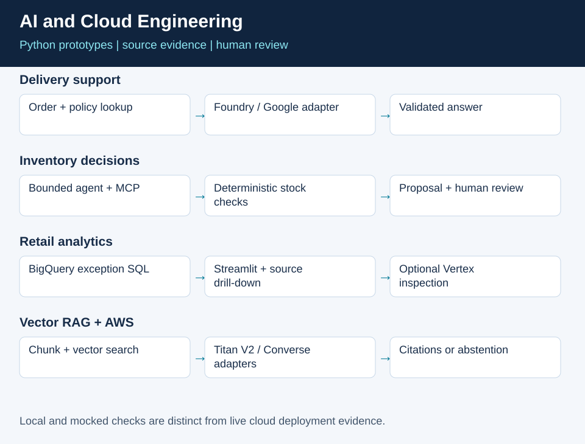
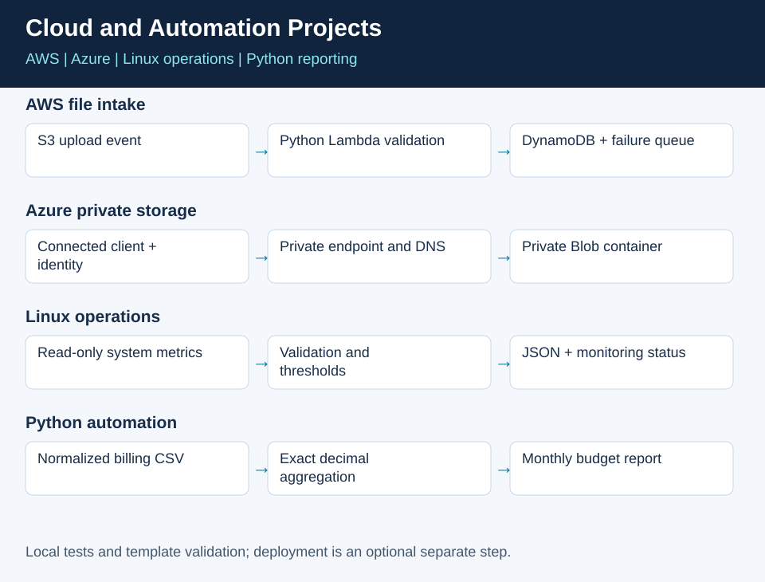

# Generative AI and Cloud Engineering Portfolio

[](https://github.com/praisedcreator/Mohammad/actions/workflows/ci.yml)

Practical Python proofs of concept and technical enablement material by **Mohammad Khalique**. Explore LLM applications, RAG, tool-using agents and cloud integrations through source code, guided demonstrations and reproducible checks.



**Reviewer shortcuts:** [Skills and code evidence](docs/skills-evidence.md) · [Guided demo](docs/guided-demo.md) · [Architecture](docs/architecture.md) · [Evaluation](docs/evaluation.md)

## Career background and project dates

My professional background includes cloud engineering at Wipro from **September 2013 to December 2020**, followed by cloud instruction and technical enablement roles. I joined **London International Studies and Research Center as Trainer AI and Data Science in September 2026**.

See the [career timeline and project register](docs/career-timeline.md) for role dates, locations and the relevant background behind each project. These examples are portfolio projects published in this repository on **26 October 2026**; they are presented separately from employer delivery history.

## Projects

| Project | What it demonstrates | Implementation scope |
| --- | --- | --- |
| [Delivery support assistant](uae-delivery-assistant-lab/) | Python, local policy retrieval for RAG, structured answers, function calling and provider adapters | Training POC with Microsoft Foundry and Google Cloud adapters; local evaluation and mocked HTTP tests |
| [Inventory review agent](inventory-agent/) and [MCP toolkit](inventory-mcp-starter/) | Bounded tool orchestration, deterministic business checks, durable proposals and human review | Fictional inventory, offline replay and separate review/simulation; optional Claude-on-Vertex adapter |
| [Retail inventory dashboard](retail-dashboard-tutorial/) | Streamlit, BigQuery SQL, exception inspection, source drill-down and Docker configuration | Configurable cloud prototype with Gemini/Vertex AI integration |
| [Vector RAG and AWS Bedrock](vector-rag-lab/) | Chunking, cosine search, source citations, abstention, Titan V2 dense embeddings and Converse | Credential-free TF-IDF demo; optional AWS adapters with real SDK stub tests |
| [AWS file metadata intake](aws-file-intake/) | S3, Python Lambda, conditional DynamoDB writes, SQS failure queue and SAM infrastructure | Local preview, real SDK stubs and CloudFormation lint; optional deployment |
| [Azure private storage](azure-private-storage/) | Bicep, private Blob storage, VNet, private endpoint, private DNS and identity-based access | Compiled ARM template and configuration guardrails; optional deployment |
| [Linux operations health check](linux-healthcheck/) | Bash, proc metrics, disk usage, CPU-normalized load and monitoring exit codes | Read-only tool, executable fixture tests and native Linux CI |
| [Python cloud cost report](python-cloud-costs/) | CSV validation, decimal arithmetic, monthly/provider grouping and budget reporting | Dependency-free CLI with fictional AWS, Azure and Google Cloud data |



## Start here

Run a guided local example with Python 3.12, from the repository root:

```powershell
python tools/demo.py
```

It shows a cited policy answer and an unrelated question that returns insufficient evidence. This command requires no packages, credentials or cloud requests. Read the [walkthrough](docs/guided-demo.md) for expected behavior and the other project demonstrations.

### Run all checks

```powershell
python -m venv .venv
.\.venv\Scripts\python.exe -m pip install -r uae-delivery-assistant-lab/requirements.txt -r inventory-mcp-starter/requirements.txt -r vector-rag-lab/requirements-aws.txt -r tools/requirements-checks.txt
.\.venv\Scripts\python.exe tools/run_checks.py
```

On macOS/Linux, use `.venv/bin/python` in place of `.\.venv\Scripts\python.exe`. Checks cover unit tests, mocked SDK contracts, offline retrieval cases, MCP integration, AWS template lint and documentation links. Linux Bash tests run natively on Ubuntu; Windows skips them unless Bash is explicitly configured. A separate CI job recompiles and compares the Azure Bicep/ARM templates. The badge above shows the actual workflow status.

### Cloud and automation quick starts

```powershell
python aws-file-intake/src/app.py
python azure-private-storage/validate.py
python python-cloud-costs/cost_report.py
```

On Linux, run `bash linux-healthcheck/healthcheck.sh`. Each project README explains the inputs, interpretation, tests and deployment prerequisites. The AWS preview and Azure guardrail command do not contact cloud services.

Read each project README before using a cloud path. Model calls require your own account configuration. Inspect the evidence and limitations before interpreting an output as a real business result.

### Run the inventory agent without credentials

```powershell
cd inventory-agent
python agent.py demo --out runs/my-demo
python -m unittest -v test_agent.py test_subagents.py
```

### Run the delivery assistant offline

```powershell
cd uae-delivery-assistant-lab
python -m venv .venv
.\.venv\Scripts\python.exe -m pip install -r requirements.txt
.\.venv\Scripts\python.exe delivery_assistant.py --provider offline --question "What do the records say about ORD-2002?"
.\.venv\Scripts\python.exe -m unittest discover -s tests -v
```

## Engineering and enablement evidence

- **LLMs and RAG:** keyword and vector baselines, document chunks, visible context, policy references, cited answers and insufficient-evidence handling.
- **AI agents:** allowlisted tools, bounded loops, proposal persistence, human review and retry-safe operations.
- **Multi-cloud:** Microsoft Foundry and Google Cloud adapters, plus AWS Bedrock embedding and generation adapters. AWS/Azure operational employment experience remains separate from these prototypes.
- **APIs and containers:** provider integrations, HTTP adapter contracts, a real MCP server and a Streamlit Dockerfile.
- **Technical enablement:** guided labs, checkpoints, a workshop plan, architecture explanations and troubleshooting guidance.
- **Evaluation:** documented local test records with a clear distinction between offline checks and live model quality.

## Documentation

- [Architecture and design decisions](docs/architecture.md)
- [Evaluation evidence and limits](docs/evaluation.md)
- [Workshop and demonstration guide](docs/workshop-guide.md)
- [Deployment and troubleshooting guide](docs/deployment-guide.md)
- [Job requirements mapped to code and evidence](docs/skills-evidence.md)
- [Guided portfolio demonstration](docs/guided-demo.md)
- [AWS Bedrock setup](docs/aws-bedrock.md)
- [Cloud and automation project guide](docs/cloud-foundations.md)
- [Contribution guide](CONTRIBUTING.md)

These are educational prototypes, not production deployments. The delivery records and inventory fixtures contain practice data. Cloud request contracts are tested with stubs/mocks; no live cloud success, customer savings or model-quality benchmark is inferred from them. Credentials, runtime state and private configuration are excluded.

## License

The original code and documentation are available under the [MIT license](LICENSE). Dependencies, third-party models, SDKs and linked resources retain their own terms.

[Professional portfolio](https://sites.google.com/view/mohammad-khalique-ai-training/home) · [LinkedIn](https://www.linkedin.com/in/mohammad-khalique-8398aa1a/)
