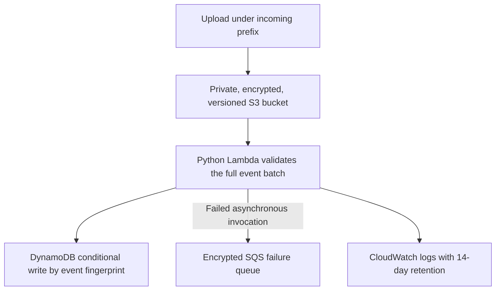

# AWS Serverless File Metadata Intake

An event-driven cloud engineering lab: an upload under `incoming/` triggers Lambda, which validates the S3 notification and records file metadata in DynamoDB. It uses conditional writes to handle duplicate event delivery and an encrypted SQS failure queue for failed asynchronous invocations.

The function stores metadata, not file contents. One item represents one unique creation event; it is not a latest-object index and does not assume notifications arrive in order. The practice event contains no customer data.



## Run without AWS

With Python 3.12, from this folder:

```powershell
python src/app.py
python -m pip install -r requirements.txt -r ../tools/requirements-checks.txt
python -m unittest -v test_intake.py
cfn-lint -t template.yaml
```

The preview only normalizes the supplied JSON. The tests use the real Boto3 client with Stubber; no HTTP requests are sent. They cover URL-decoded keys, event identity, invalid batches, duplicate delivery and service errors.

## Template behavior

- S3 public access is blocked, ACLs are disabled, versioning and server-side encryption are enabled, and a retained bucket policy denies plaintext transport.
- Lambda has DynamoDB `PutItem` permission scoped to this table. SAM adds logging and failure-queue permissions. The function does not download, modify or delete S3 objects.
- DynamoDB uses on-demand billing, encryption and point-in-time recovery. The bucket, bucket policy and table are retained if the stack is deleted or replaced.
- Failed invocations use Lambda's asynchronous retry/dead-letter behavior. A later retry may contain records already written; the conditional key prevents those records being written again.

## Optional deployment

Install the official AWS SAM CLI and configure your own approved AWS account and region. Review the template, IAM changes, account concurrency quotas and expected charges first. Nothing in the repository test workflow deploys it.

```powershell
sam build --template-file template.yaml
sam deploy --guided --stack-name portfolio-file-intake --region YOUR-REGION --capabilities CAPABILITY_IAM
```

Use the stack's `BucketName` output to upload `sample-event.json` under `incoming/`. Inspect the table and function logs using an authorized identity. Uploading the same filename again creates a new version/event; that is different from receiving the same notification twice.

Deployments create billable resources. Retained data and its bucket policy remain after stack deletion and need a deliberate lifecycle decision. No live deployment, delivery guarantee or production throughput result is claimed here.

## Troubleshooting and extensions

For missing rows, check the `incoming/` prefix, Lambda logs, table IAM permission and failure queue. Access errors are propagated rather than labelled duplicates. A malformed record causes the whole batch to fail validation before writes start. This design does not order different versions; extend it with sequencer-aware state if a latest-version index is required.

References: [S3 notifications and Lambda](https://docs.aws.amazon.com/lambda/latest/dg/with-s3.html), [SAM S3 event source](https://docs.aws.amazon.com/serverless-application-model/latest/developerguide/sam-property-function-s3.html).
