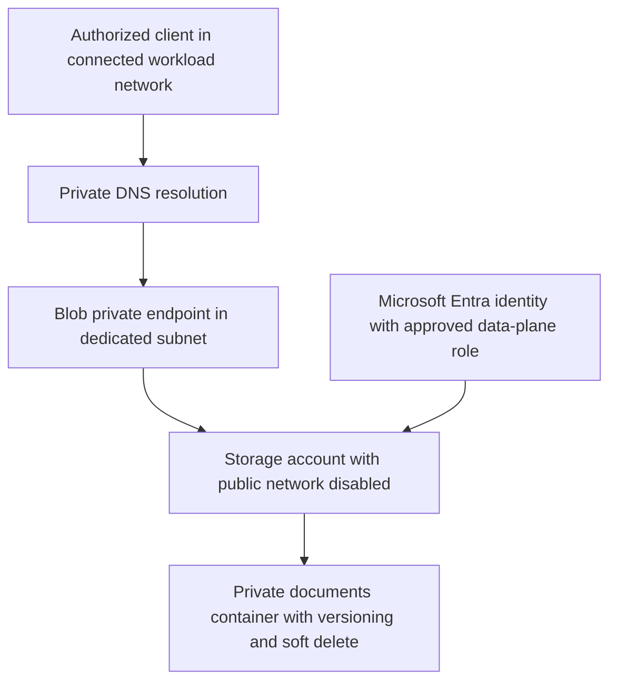

# Azure Private Blob Storage Foundation

A Bicep infrastructure project for a private document-storage landing zone. It creates a StorageV2 account, private container, VNet, Blob private endpoint, private DNS zone and VNet/DNS links. It demonstrates network isolation, identity-based access and repeatable infrastructure review.



## What the template enforces

Public network access, anonymous blobs and shared-key authorization are disabled. HTTPS and TLS 1.2 are required. Blob encryption, versioning and seven-day soft delete are enabled. Private endpoint DNS registration and the VNet link are included. DNS suffixes follow the Azure cloud environment rather than a hardcoded public-cloud suffix.

The template does not deploy a client VM, VPN, peering or role assignment. A connected client and an approved Storage Blob Data Reader/Contributor role are separate prerequisites. Subscription control-plane ownership alone does not establish blob data-plane access.

## Validate without an Azure account

Install Microsoft's Bicep CLI, version `0.48.1`, then run:

```powershell
bicep build main.bicep --outfile main.json
python validate.py
python -m unittest -v test_storage.py
```

The committed `main.json` is the compiled ARM equivalent. CI recompiles the Bicep with the pinned compiler, compares both representations and runs guardrails against changes that would expose public access, disable encryption, disconnect private DNS or emit storage credentials. Compilation and guardrails do not verify live connectivity or RBAC.

## Optional Azure deployment

Use your own authorized Azure CLI session, resource group and approved region. Check whether the `10.42.0.0/16` address space conflicts with existing networks. The resources include a billable private endpoint and storage services.

```powershell
az deployment group what-if --resource-group YOUR-RESOURCE-GROUP --template-file main.bicep
az deployment group create --resource-group YOUR-RESOURCE-GROUP --template-file main.bicep
```

These commands are instructions for a separately authorized deployment; repository tests never run them. After deployment, use a client connected to the VNet, resolve the storage Blob endpoint to a private address, and inspect the `documents` container with an identity that has an approved data-plane role. For example, use `az storage blob list --account-name YOUR-STORAGE-ACCOUNT --container-name documents --auth-mode login` from that connected client.

## Troubleshooting

A 403 can indicate missing data-plane RBAC or a blocked network path. Check both. A public DNS answer can indicate a missing VNet link, private endpoint zone group or DNS forwarding path. The storage endpoint remains inaccessible from an unconnected laptop by design. Do not enable shared keys or public networking merely to make the private-connectivity test pass.

References: [Storage account resource schema](https://learn.microsoft.com/en-us/azure/templates/microsoft.storage/2023-05-01/storageaccounts), [Azure Storage network access](https://learn.microsoft.com/en-us/azure/storage/common/storage-network-security-set-default-access), [Bicep releases](https://github.com/Azure/bicep/releases/tag/v0.48.1).
