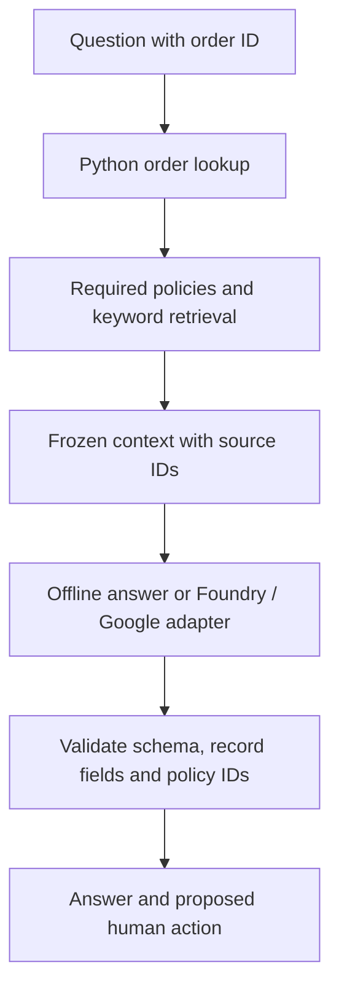
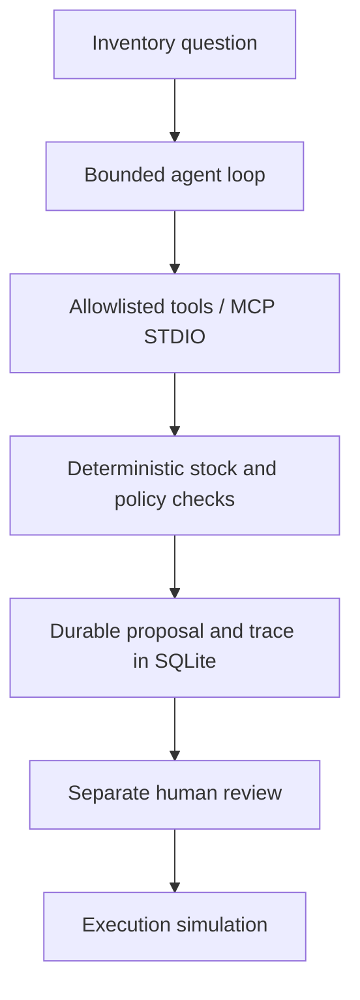
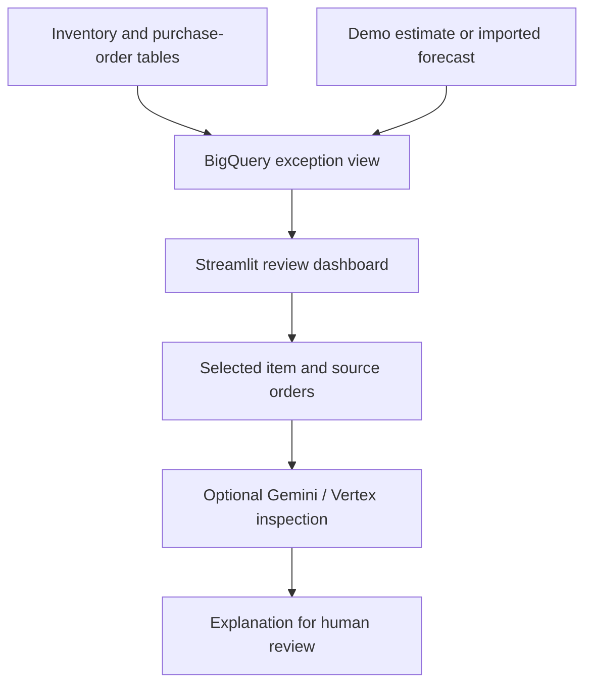
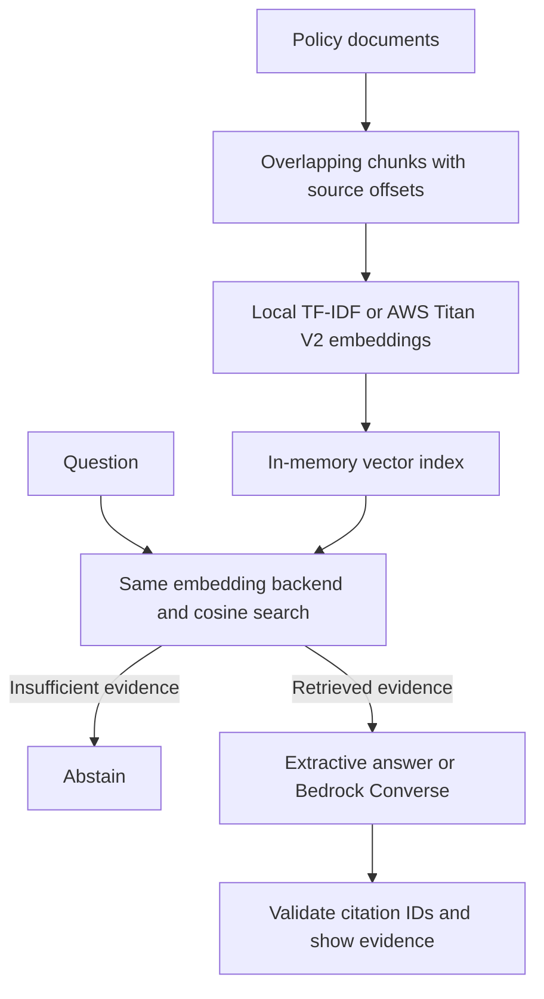

# Architecture and Design Decisions

## Delivery support assistant

Python selects an order, retrieves relevant practice policy passages and passes the frozen context to a model adapter. A structured response schema and record checks constrain the returned fields. The basic path retrieves first; the advanced exercise lets the model request a controlled lookup function.

This is a local rule/keyword retrieval baseline, not an embeddings or managed vector-search deployment. Shared context and a shared schema make provider comparisons easier to inspect. A comparison file is only evidence of live integration when both configured providers actually complete a request.

## Inventory review agent and MCP tools

The parent agent orchestrates a bounded tool loop. Python checks stock coverage, pack sizes, source protection and transport cost. A saved proposal has a hash and state. Review and simulation happen through a separate interface; they are not tools available to the model. The optional policy specialist is read-only and cannot approve a proposal.

The MCP implementation exposes six tools over STDIO, persists proposals/traces in SQLite and enforces safe retries. The coding client supplies any AI model. The smoke client is scripted and does not prove an AI model made a correct decision.

## Retail dashboard

BigQuery SQL produces validated inventory exceptions and daily stock projections. Streamlit reads that view, selects an item and retrieves its order records. Optional model inspection receives the selected evidence. The business calculations remain in SQL rather than in generated prose.

## Vector RAG and AWS Bedrock

The new [vector lab](../vector-rag-lab/README.md) chunks the same practice policies with stable IDs and source offsets. The local path creates TF-IDF vectors; an optional Bedrock path calls Titan V2 for dense embeddings. Document and query vectors use the same backend and dimensionality. Cosine search applies a threshold and returns an empty result when evidence is insufficient.

The local answer quotes a retrieved passage. Optional Converse generation receives the retrieved chunks as data and returns JSON. Citation IDs must belong to the retrieved set, and non-text, truncated or malformed outputs are rejected. This verifies structural boundaries, not complete semantic correctness. Cloud adapters have SDK contract tests rather than a live deployment result.

## Design trade-offs

- Keep deterministic arithmetic in code/SQL and use the model for explanation or tool selection.
- Keep operational permissions in the application, not in a prompt alone.
- Keep a small retrieval baseline so an added search service can be evaluated against the same cases.
- Keep cloud adapters separate from the shared business logic.
- Record what was actually tested. A container definition or adapter is not a deployment record.
