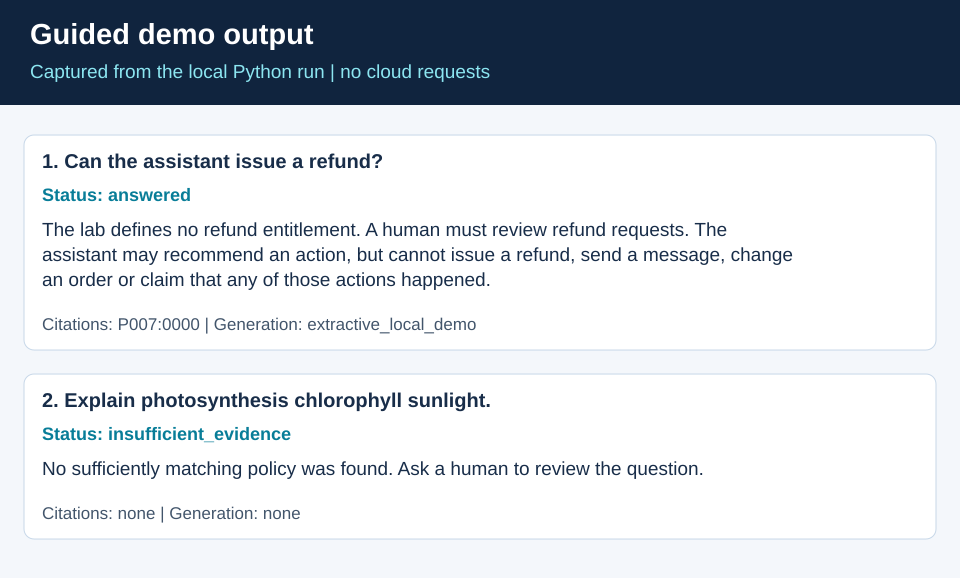

# Guided Portfolio Demonstration

Use this walkthrough to inspect the business task, source evidence and behavior before configuring a cloud service. The first demonstration needs only Python 3.12. All examples use practice data.

## One command to start

From the repository root:

```powershell
python tools/demo.py
```

The first question asks whether the assistant can issue a refund. The answer quotes the retrieved policy, includes a source/chunk reference and explains that human review is required. The second question is outside the policy corpus and returns `insufficient_evidence`. The output states that generation is local/extractive.



## Inspect a historical order

After the dependency setup in [CONTRIBUTING](../CONTRIBUTING.md):

```powershell
cd uae-delivery-assistant-lab
python delivery_assistant.py --provider offline --question "What do the records say about ORD-2002?"
python delivery_assistant.py --provider offline --question "Where is ORD-9999?"
```

Compare the returned order ID, recorded outcome, policy IDs and proposed action with the source CSV and policies. An unknown ID must not borrow another record. The dataset has historical outcomes, not live tracking or a trained ETA prediction.

## Inspect the inventory decision boundary

```powershell
cd inventory-agent
python agent.py demo --out runs/guided-demo
python -m unittest -v test_agent.py test_subagents.py
```

Inspect the proposed transfer, stock checks and trace. A model or scripted agent can request a proposal, while review and execution simulation remain separate. No actual ERP transfer is performed.

The [MCP README](../inventory-mcp-starter/README.md) then shows the same business checks through protocol tools. Run `python smoke_test.py` inside that project to exercise the server through a real local subprocess.

## Review the dashboard implementation

Follow the [retail dashboard setup](../retail-dashboard-tutorial/README.md) with your own Google Cloud configuration. Inspect the SQL data-quality flags and drill-down query before connecting a model. A displayed demo estimate must stay distinct from an imported model forecast. This repo does not include a verified live BigQuery/Streamlit deployment screenshot.

## Optional AWS extension

Use the [Bedrock setup guide](aws-bedrock.md) only when ready to make configured cloud requests. Start with local retrieval plus one Converse request, then compare the dense-embedding path against the same questions. Review citation support manually; similarity and schema validation do not establish complete factual accuracy.

## Audience discussion

For a business audience, explain the decision, supporting record and human action. For engineers, explain the retrieval representation, API schema, tool permissions, failure handling and tests. Use the [skills evidence map](skills-evidence.md) to locate each implementation.
