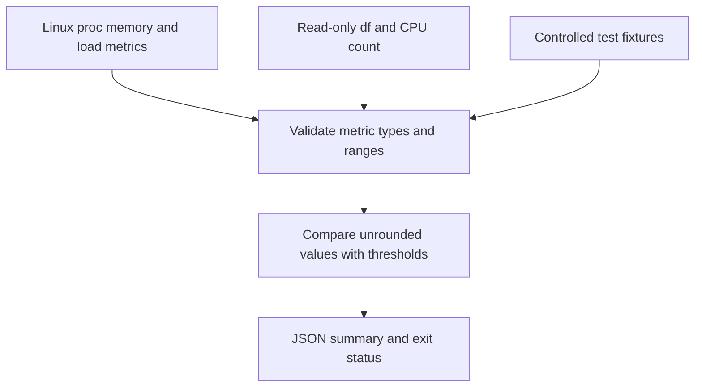

# Linux Operations Health Check

A read-only Bash tool for inspecting Linux memory pressure, filesystem usage and one-minute load per logical CPU. It emits JSON and returns an exit code suitable for a monitoring wrapper. It never restarts services, edits configuration, changes permissions or requires sudo.



## Run on Linux

```bash
bash healthcheck.sh
bash healthcheck.sh --disk-path /var
python3 -m unittest -v test_healthcheck.py
```

Requirements are Bash, awk and standard Linux core utilities. Live mode reads `/proc/meminfo`, `/proc/loadavg`, `df -Pk` and the logical CPU count. Load is normalized by the logical CPU count; it is a lab heuristic, not a complete measure of application health.

| Exit code | Meaning |
| --- | --- |
| 0 | Supplied metrics are below the lab warning thresholds |
| 1 | Memory or disk usage is at least 85%, or one-minute load per CPU is at least 1.5 |
| 2 | Invalid arguments, unavailable metrics or invalid metric values |

Threshold comparisons use unrounded numbers. A displayed rounded percentage therefore cannot accidentally turn a below-threshold value into a warning.

## Fixture testing

The tests create project-local temporary files, execute the real Bash script and verify thresholds, malformed data, missing metrics, read-only behavior and shell metacharacter handling. `--fixture-dir DIRECTORY` expects `meminfo`, `loadavg`, `disk_percent` and `cpu_count` files. A healthy fixture in the tests produces 40% memory usage, 25% disk usage and 0.25 load per CPU.

On Windows, tests skip unless `PORTFOLIO_BASH` explicitly identifies an installed Bash executable. Git Bash can exercise fixtures; it does not provide a live Linux health measurement. GitHub Actions runs the fixture suite natively on Ubuntu.

## Operational follow-up

Use the JSON as evidence for investigation. For a warning, inspect workload demand, storage growth and application metrics before choosing an intervention. The script has no remediation action, process inventory, credential collection or remote upload. A healthy summary does not replace application availability checks.
