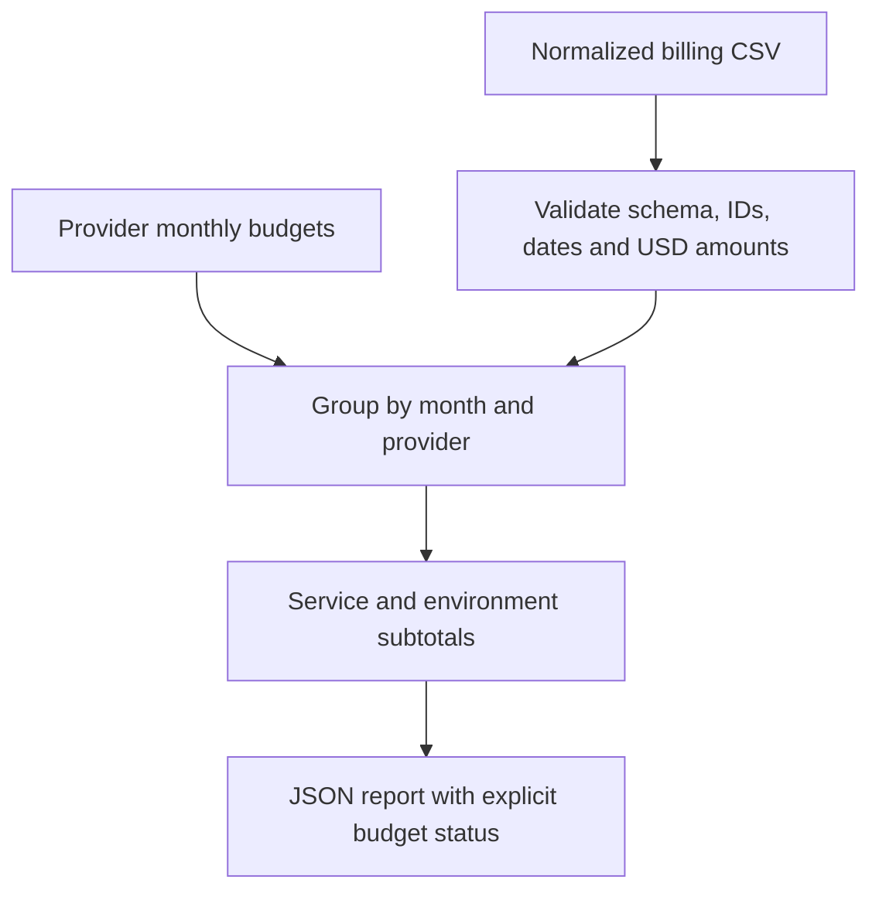

# Python Multi Cloud Cost Report

A dependency-free Python CLI that validates a normalized billing CSV, aggregates monthly AWS/Azure/Google Cloud spend and compares it with configured monthly budgets. It demonstrates CSV processing, exact decimal arithmetic, structured reporting, input validation and automated tests.



## Run

With Python 3.12, from this folder:

```powershell
python cost_report.py
python cost_report.py --input sample-costs.csv --budgets budgets.json
python -m unittest -v test_costs.py
```

No packages, account credentials, API requests or cloud resources are needed. Sample data is fictional. Its September totals are AWS **USD 433.75**, Azure **USD 455.00**, and Google Cloud **USD 27.40**. The example AWS budget is approaching its limit and the Azure total exceeds its configured budget.

## Input contract

Use columns in this order: `record_id,date,provider,service,environment,currency,cost`. Providers are `aws`, `azure` and `gcp`; dates use `YYYY-MM-DD`; currency is `USD`. Amounts are nonnegative decimal strings with at most two fraction digits and up to 15 integer digits. The provider/record-ID pair must be unique. Empty files and incomplete, duplicate or malformed rows fail validation.

This is a normalized input format, not a direct parser for every vendor billing export. Map the required fields from an authorized export first. Negative credits, currency conversion, forecasts and savings claims are outside this lab's scope.

`budgets.json` maps each provider to a positive monthly USD budget string. The same configured provider budget is applied independently to each month in the input. A missing provider budget is reported as `NO_BUDGET`, not as healthy.

## Report interpretation

- `WITHIN_BUDGET`: below 80% of the configured monthly amount.
- `APPROACHING_BUDGET`: from 80% through exactly 100%.
- `OVER_BUDGET`: greater than the configured amount.
- `NO_BUDGET`: no budget was supplied for that provider.

Threshold comparisons use exact amounts; presentation rounding does not determine the status. Service and environment subtotals reconcile to each provider/month total. These are historical totals from supplied rows, not month-end projections or a complete invoice reconciliation.
