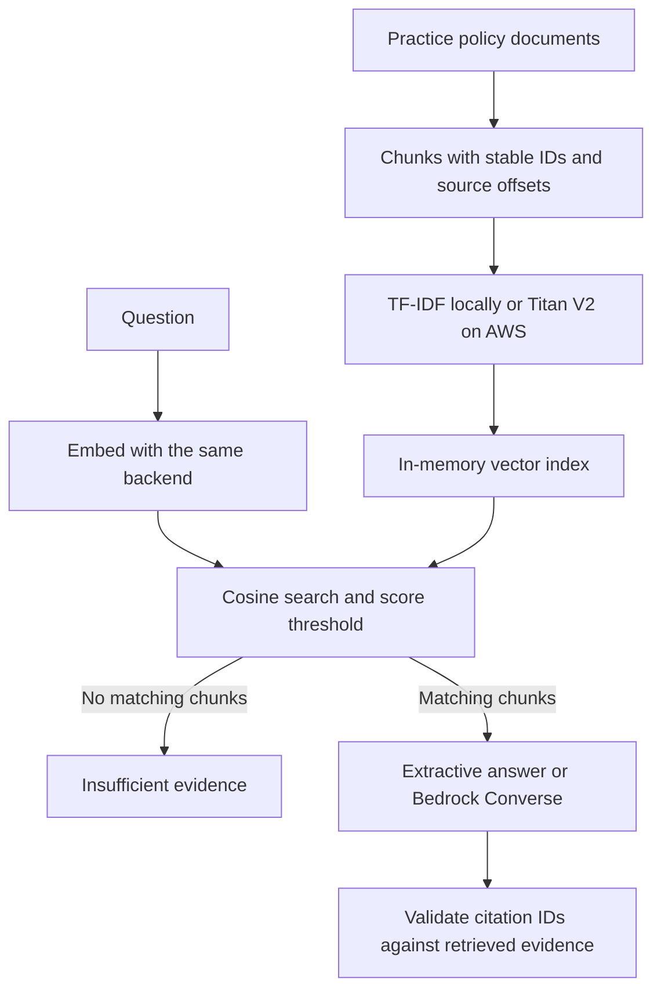

# Vector RAG and Amazon Bedrock Lab

A small Python example of document chunking, vector retrieval, cited answers and insufficient-evidence handling. It reuses the fictional delivery policies from the existing lab. The local demo runs without packages or credentials; optional AWS adapters implement Titan V2 dense embeddings and Converse answer generation.

## Run the local demo

From the repository root:

```powershell
python tools/demo.py
```

For the full retrieved evidence:

```powershell
cd vector-rag-lab
python rag.py --question "Can the assistant issue a refund?"
python rag.py --question "Explain photosynthesis chlorophyll sunlight."
python rag.py --evaluate
```

The first question retrieves the refund policy and includes its chunk/source citation. The second returns `insufficient_evidence`. Local answers copy the best matching policy passage. They are extractive demonstrations, not LLM responses. The ten evaluation cases check retrieval and abstention on a small fixed corpus; they do not establish general answer quality.

## Retrieval backends

| Backend | Representation | What has been checked |
| --- | --- | --- |
| `local` | TF-IDF text vectors with cosine search; unknown-word mass is retained | Local retrieval, chunk boundaries, citations, abstention and regression cases |
| `bedrock` | Titan Text Embeddings V2, 256-dimensional dense vectors; in-memory cosine search | Request/response contracts using the real Boto3 SDK with Stubber; live AWS model behavior is unverified |

The local backend is lexical vector search, not a pretrained semantic embedding model. The Bedrock backend implements the semantic-embedding integration and needs a configured AWS account. There is no external vector database: the small index lives in memory and is rebuilt on each run.



## Optional AWS path

Install the pinned SDK in a virtual environment, authenticate through your own AWS SSO/profile, and select a region/model available to your account. The `.env.example` lists configuration names; it is not automatically loaded.

```powershell
python -m venv .venv
.\.venv\Scripts\python.exe -m pip install -r requirements-aws.txt
$env:AWS_REGION = "YOUR-APPROVED-REGION"
$env:BEDROCK_MODEL_ID = "YOUR-CONVERSE-MODEL-OR-INFERENCE-PROFILE"

# One LLM request using locally retrieved evidence:
.\.venv\Scripts\python.exe rag.py --generator bedrock --allow-cloud-calls --question "Can the assistant issue a refund?"

# Dense embeddings for the corpus and question, followed by one LLM request:
.\.venv\Scripts\python.exe rag.py --backend bedrock --generator bedrock --allow-cloud-calls --question "Can the assistant issue a refund?"
```

Replace placeholders before running. For macOS/Linux, use `.venv/bin/python` and `export VARIABLE=value`. Cloud mode sends the practice policies and questions to AWS and incurs normal AWS usage charges. The dense index is rebuilt each run, so corpus embedding calls repeat. This repository does not create AWS resources or credentials.

See the [AWS setup and troubleshooting guide](../docs/aws-bedrock.md) for permissions, model selection and known limits.

## Tests

```powershell
.\.venv\Scripts\python.exe -m unittest -v test_rag.py
```

The suite covers chunk overlap, duplicate IDs, source offsets, vector dimensions, invalid values, query limits, unrelated questions, forged citation IDs, AWS opt-in, truncated responses and AWS access errors. SDK stubs verify `InvokeModel` and `Converse` without network requests.

## Design limits

The score threshold is a lab heuristic, not a calibrated confidence probability. Tune and evaluate it for a different corpus or embedding model. Valid citation IDs prove that a reference was retrieved; they do not prove that every generated statement follows from it. Model prose needs human review. The lab does not offer live delivery tracking, refund execution or production access controls.
